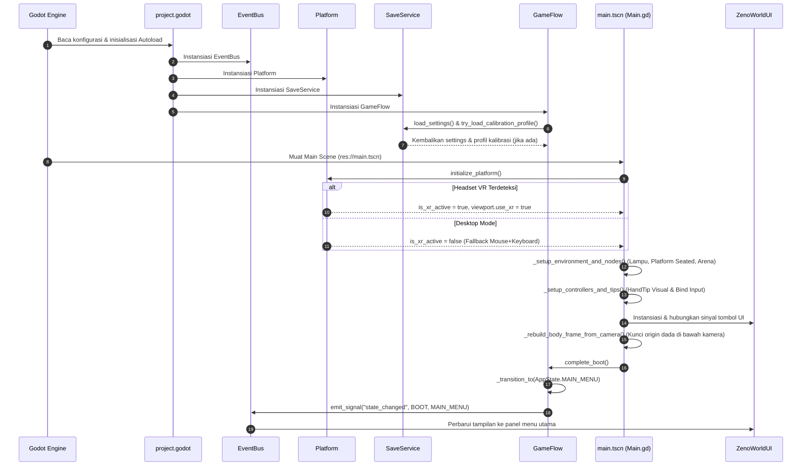
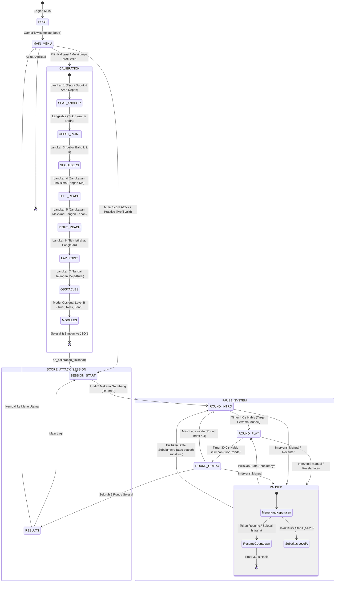
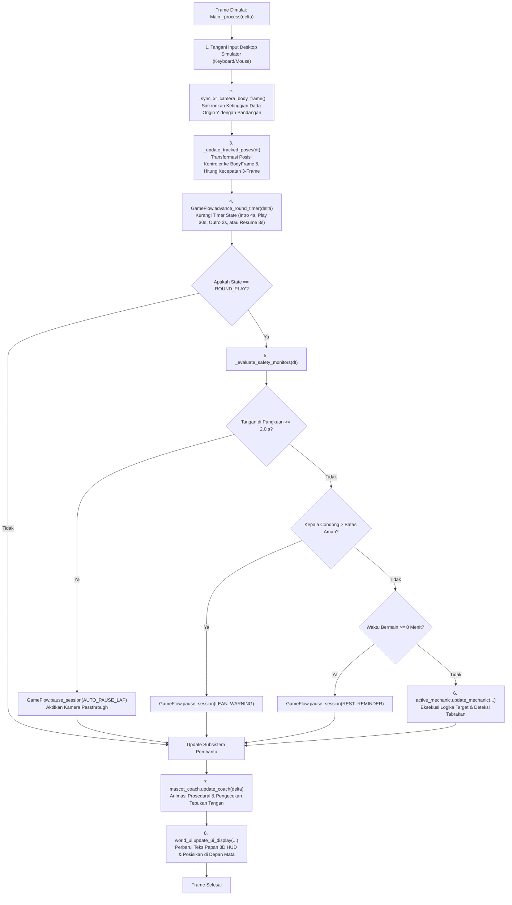
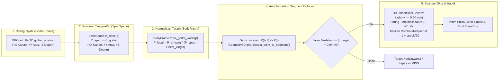
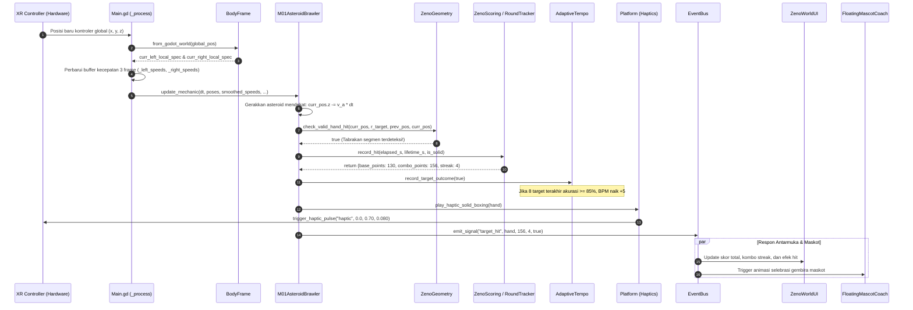

# Pemetaan Arsitektur Teknis & Alur Program ZenoFit (Godot 4.7)

> [!NOTE]
> **Tujuan Dokumen**: Memetakan arsitektur perangkat lunak, hierarki kontrol (*who controls what*), mesin keadaan (*state machine*), alur data pelacakan (*input & tracking pipeline*), siklus hidup ronde (*session & round lifecycle*), dan komunikasi antar-subsistem pada game VR latihan duduk *ZenoFit* berbasis **Godot 4.7** (`GodotMockup/mockup-v-1/`).

---

## 1. Peta Hirarki Arsitektur: Siapa Mengontrol Siapa (*Who Controls What*)

Arsitektur *ZenoFit* dibangun menggunakan pola **Mediator-Orchestrator** berbasis node dan *Autoload Singleton*, dipadukan dengan **Event-Driven Architecture** melalui `EventBus` global untuk mencegah ketergantungan melingkar (*circular dependencies*).

```mermaid
graph TD
    subgraph EngineAndHardware ["1. Engine & Hardware Layer"]
        OpenXR["OpenXR Runtime / Desktop Simulator"]
        ProjectGodot["project.godot (Main Scene: main.tscn)"]
    end

    subgraph AutoloadLayer ["2. Global Autoload Singletons (Service Layer)"]
        EventBus["EventBus (autoload/event_bus.gd)\nSinyal Global / Decoupled Broker"]
        Platform["Platform (autoload/platform.gd)\nOpenXR Abstraction, Haptics, Passthrough"]
        SaveService["SaveService (autoload/save_service.gd)\nJSON Persistence: user://"]
        GameFlow["GameFlow (autoload/game_flow.gd)\nMaster Game Manager & AppState Machine"]
    end

    subgraph SceneCoordinator ["3. Scene Coordinator (Controller Layer)"]
        Main["Main (main.gd / XROrigin3D)\nKoordinator Hardware, Pelacakan, Kamera, & Arena"]
    end

    subgraph HardwareNodes ["4. XR Hardware Tracker Nodes"]
        XRCamera["XRCamera3D (Headset / Mata)"]
        LeftCtrl["LeftController (XRController3D)"]
        RightCtrl["RightController (XRController3D)"]
    end

    subgraph CoreMath ["5. Core Mathematics & Coordinate Transformers"]
        SpecSpace["SpecSpace (core/spec_space.gd)\nKonversi Left-Handed <-> Right-Handed"]
        BodyFrame["BodyFrame (core/body_frame.gd)\nKoordinat Lokal Dada Seated"]
        ComfortProfile["ComfortProfile (core/comfort_profile.gd)\nData Antropometri & Jangkauan Kalibrasi"]
        ZenoGeometry["ZenoGeometry (core/geometry.gd)\nAnti-Tunnelling Segment-to-Sphere"]
        MechanicsMath["MechanicsMath (core/mechanics_math.gd)\nFormula Khusus M01-M10"]
        AdaptiveTempo["AdaptiveTempo (core/adaptive_tempo.gd)\nRegulator BPM Adaptif 8-Target"]
        ZenoScoring["ZenoScoring (core/scoring.gd)\nTimeliness, Streak, & Combo Multiplier"]
    end

    subgraph ActiveSubsystems ["6. Runtime Subsystems & Gameplay Workers"]
        CalibrationCtrl["CalibrationController (calibration/)"]
        SafetyMonitors["SafetyMonitors (safety/safety_monitors.gd)\nAutoPause, LeanMonitor, RestReminder"]
        ActiveMechanic["Active Mechanic (mechanics/m01..m10)\nTransient Gameplay Worker"]
        ArenaRoot["SessionArena (Node3D)\nContainer Visual Objek Target 3D"]
        MascotCoach["FloatingMascotCoach (mascot/)\nPelatih 3D Prosedural GLB"]
        WorldUI["ZenoWorldUI (ui/world_ui.gd)\n3D Eye-Level Billboard HUD + 2D Overlay"]
    end

    %% Relasi Kontrol & Data
    ProjectGodot --> Main
    OpenXR --> Platform
    OpenXR --> XRCamera
    OpenXR --> LeftCtrl
    OpenXR --> RightCtrl

    Main --> XRCamera
    Main --> LeftCtrl
    Main --> RightCtrl
    Main --> ArenaRoot
    Main --> MascotCoach
    Main --> WorldUI
    Main --> CalibrationCtrl
    Main --> SafetyMonitors

    GameFlow --> SaveService
    GameFlow --> AdaptiveTempo
    GameFlow --> ComfortProfile
    GameFlow --> BodyFrame

    Main -.->|Mengatur & Men-tick Per Frame| ActiveMechanic
    ActiveMechanic -.->|Membuat Mesh Target 3D| ArenaRoot

    Main --> SpecSpace
    Main --> BodyFrame

    %% Event Bus Signals
    ActiveMechanic -.->|target_hit / target_missed| EventBus
    Main -.->|button_pressed / recentered| GameFlow
    GameFlow -.->|state_changed / round_started / round_ended| EventBus
    SafetyMonitors -.->|pause_session| GameFlow
    EventBus -.->|Update Tampilan| WorldUI
    EventBus -.->|Reaksi Gestur / Demo Bentuk| MascotCoach
```

### Tabel Peran dan Tanggung Jawab Komponen

| Komponen / Script | Jenis | Siapa yang Mengontrolnya | Apa yang Dikontrol / Dimilikinya | Bukti Lokasi File (`VERIFIED_IN_CODE`) |
| :--- | :--- | :--- | :--- | :--- |
| **`GameFlowController`** | `Autoload Node` | Engine saat boot; menerima aksi dari tombol UI / input pemain. | **Penguasa Siklus Hidup Permainan**: Mengontrol mesin keadaan `AppState`, timer ronde (Intro 4s, Play 30s, Outro 2s), undian mekanik seimbang (`SessionDraw`), skor kombo (`RoundScoreTracker`), dan tempo adaptif (`AdaptiveTempo`). | [autoload/game_flow.gd](file:///home/ramirez/XR-FP/GodotMockup/mockup-v-1/autoload/game_flow.gd) |
| **`Main` (`XROrigin3D`)** | `Scene Root Node` | Scene Tree Godot (`run/main_scene`). | **Koordinator Fisik & Perangkat**: Membaca posisi hardware (`XRCamera3D`, `XRController3D`), menormalkan koordinat ke `BodyFrame`, menjalankan monitor keselamatan, menginstansiasi mekanik aktif (`M01`–`M10`), serta memperbarui `FloatingMascotCoach` dan `ZenoWorldUI`. | [main.gd](file:///home/ramirez/XR-FP/GodotMockup/mockup-v-1/main.gd) |
| **`EventBus`** | `Autoload Node` | Dipanggil oleh semua sistem sebagai penyedia sinyal. | **Pialang Pesan Global (*Message Broker*)**: Menyediakan sinyal *decoupled* seperti `state_changed`, `round_started`, `target_hit`, `session_paused`, dan `mascot_demo_requested`. | [autoload/event_bus.gd](file:///home/ramirez/XR-FP/GodotMockup/mockup-v-1/autoload/event_bus.gd) |
| **`Platform`** | `Autoload Node` | Engine OpenXR. | **Abstraksi Perangkat Keras**: Mengontrol inisialisasi OpenXR, getaran haptik kontroler (`trigger_haptic_pulse`), aktivasi kamera tembus pandang (*passthrough* alpha blend), dan sinyal *recenter*. | [autoload/platform.gd](file:///home/ramirez/XR-FP/GodotMockup/mockup-v-1/autoload/platform.gd) |
| **`SaveServiceClass`** | `Autoload Node` | Dipanggil oleh `GameFlow`. | **Penyimpanan Permanen Disk**: Membaca dan menulis profil kalibrasi (`calibration_profile.json`), riwayat sesi (`sessions.json`), dan preferensi (`settings.json`) ke direktori `user://` (atau `/tmp/zenofit_userdata/` saat headless/sandbox). | [autoload/save_service.gd](file:///home/ramirez/XR-FP/GodotMockup/mockup-v-1/autoload/save_service.gd) |
| **`MechanicBase` (Turunan `M01`–`M10`)** | `RefCounted Object` | Diinstansiasi dan di-tick setiap frame oleh `main.gd` selama state `ROUND_PLAY`. | **Pekerja Gameplay Spesifik**: Menggerakkan target minigame, memvalidasi tabrakan segmen tangan ke bola target, menghitung sudut kemudi/muatan/tahanan, dan melaporkan *hit/miss*. | [mechanics/mechanic_base.gd](file:///home/ramirez/XR-FP/GodotMockup/mockup-v-1/mechanics/mechanic_base.gd) |
| **`SafetyMonitors`** | `RefCounted Objects` | Dimiliki dan dievaluasi setiap frame oleh `main.gd`. | **Pencegah Cedera Otomatis**: Memantau tangan istirahat di pangkuan (`AutoPauseMonitor` $\ge 2.0\text{ s}$), condong tubuh berlebih (`LeanMonitor` $> 0.20\text{ m}$), dan pengingat istirahat leher (`RestReminderMonitor` tiap $8\text{ menit}$). | [safety/safety_monitors.gd](file:///home/ramirez/XR-FP/GodotMockup/mockup-v-1/safety/safety_monitors.gd) |
| **`FloatingMascotCoach`** | `Node3D` (Anak `Main`) | Diperbarui per frame oleh `main.gd`. | **Pelatih Visual Interaktif**: Memuat model 3D `Floating Mascots.glb`, mendemonstrasikan gerakan mekanik aktif secara anatomis, dan bereaksi saat disentuh/ditepuk pemain. | [mascot/floating_mascot_coach.gd](file:///home/ramirez/XR-FP/GodotMockup/mockup-v-1/mascot/floating_mascot_coach.gd) |
| **`ZenoWorldUI`** | `Node3D` (Anak `Main`) | Diperbarui per frame oleh `main.gd`. | **Antarmuka 3D Setinggi Mata**: Papan billboard 3D yang mengambang mengikuti arah pandangan mata pemain (*lazy follow*), menampilkan instruksi langkah kalibrasi, petunjuk mekanik, sisa waktu, dan papan skor. | [ui/world_ui.gd](file:///home/ramirez/XR-FP/GodotMockup/mockup-v-1/ui/world_ui.gd) |

---

## 2. Alur Inisialisasi Program (*Boot Sequence*)

Urutan langkah teknis dari saat aplikasi dibuka hingga menu utama siap menerima input:

---

## 3. Mesin Keadaan Lengkap (*AppState Machine*)

Siklus hidup permainan diatur secara ketat oleh variabel `GameFlow.current_state` yang mengimplementasikan enum `ZenoEnums.AppState` ([enums.gd:4-14](file:///home/ramirez/XR-FP/GodotMockup/mockup-v-1/core/enums.gd#L4-L14)):

### Rincian Alasan Jeda Darurat (*Pause Reasons*):
1. **`MANUAL`**: Pemain menekan tombol menu kontroler (`menu_button`) atau tombol `Esc`.
2. **`AUTO_PAUSE_LAP`**: Kedua tangan diletakkan di pangkuan ($d \le 0.15\text{ m}$ dari titik pangkuan) selama $\ge 2.0\text{ s}$ ([safety_monitors.gd:22](file:///home/ramirez/XR-FP/GodotMockup/mockup-v-1/safety/safety_monitors.gd#L22)). Mode passthrough kamera otomatis aktif.
3. **`LEAN_WARNING`**: Kepala condong ke samping melampaui batas aman ($> 0.20\text{ m}$ untuk Level A, atau batas khusus untuk M10) selama $\ge 0.50\text{ s}$.
4. **`REST_REMINDER`**: Pemain telah bermain selama $8.0\text{ menit}$ berturut-turut untuk mencegah ketegangan leher akibat bobot headset.
5. **`RECENTER_REQUIRED`**: Sistem OpenXR mendeteksi tombol *recenter* ditekan; permainan menjeda seketika dan meminta konfirmasi posisi duduk baru (`AT-16`).
6. **`STABLE_CHAIR_CONFIRMATION`**: Sebelum mekanik Level B (`M04`, `M08`, `M10`) dimulai, sistem meminta konfirmasi bahwa kursi yang digunakan tidak berputar/terkunci stabil. Jika ditolak, sistem memanggil `decline_stable_chair_and_substitute()` untuk menukar mekanik ke Level A (`AT-28`).

---

## 4. Alur Pemrosesan Frame (*Per-Frame Execution Pipeline*)

Setiap frame pada fungsi `Main._process(delta)` di [main.gd:188-269](file:///home/ramirez/XR-FP/GodotMockup/mockup-v-1/main.gd#L188-L269) mengeksekusi pipeline berurutan:

---

## 5. Pipeline Transformasi Koordinat & Deteksi Tabrakan (*Math & Geometry Pipeline*)

Seluruh perhitungan gerak pemain dan kemunculan target diisolasi dari koordinat dunia Godot agar tidak terpengaruh oleh orientasi ruangan nyata pemain:

---

## 6. Diagram Alur Data Saat Sesi Gameplay (*Data Flow Sequence*)

Diagram berikut menggambarkan pertukaran data waktu-nyata (*real-time*) saat seorang pemain memukul asteroid pada mekanik **`M01 Asteroid Brawler`**:

---

## 7. Rangkuman Integrasi & Batasan Arsitektur

1. **Pemisahan Logika Matematika dan Rendering (Aturan Desain #11)**:
   - Seluruh rumus kalkulasi mekanik (`M01`–`M10`), evaluasi jangkauan kalibrasi, histeresis, dan skor ditempatkan di class statis murni tanpa ketergantungan visual (`MechanicsMath`, `BodyFrame`, `SpecSpace`, `ZenoGeometry`, `ZenoScoring`).
   - Node visual 3D target hanya bertindak sebagai representasi visual yang posisinya diperbarui melalui transformasi `body_frame.to_godot_world(pos_spec)`.
2. **Ketergantungan Siklus Terputus Melalui `EventBus`**:
   - `M01`–`M10` tidak pernah memanggil `ZenoWorldUI` atau `FloatingMascotCoach` secara langsung. Semua komunikasi keberhasilan, kegagalan, dan peringatan keselamatan melewati sinyal `EventBus`.
3. **Penyelaras Tinggi Otomatis (*Adaptive Eye-Level Alignment*)**:
   - Fungsi `_sync_xr_camera_body_frame()` pada [main.gd:228-235](file:///home/ramirez/XR-FP/GodotMockup/mockup-v-1/main.gd#L228-L235) memastikan bahwa ketika pemain menyesuaikan posisi duduk atau bantal kursi, ketinggian titik dada `origin_spec.y` secara halus diselaraskan kembali secara lerp ($18\%$ per frame) tanpa merusak kalibrasi horizontal.
