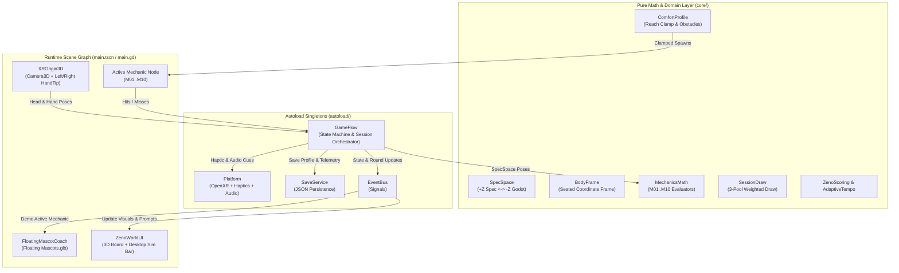
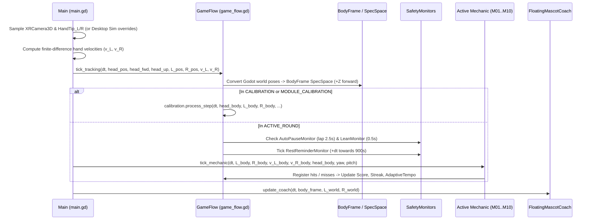

# ZenoFit (Godot 4.x) — Architecture & How the Project Works

This document explains the software architecture, scene hierarchy, data flow, and subsystem interactions of the ZenoFit Godot 4.x implementation (`mockup-v-1`).

---

## 1. High-Level Architectural Overview

ZenoFit is structured using **Separation of Concerns (SoC)**:
1. **Pure Domain & Math Layer (`core/`)**: Stateless or `RefCounted` classes (`SpecSpace`, `BodyFrame`, `ComfortProfile`, `MechanicsMath`, `SessionDraw`, `ZenoScoring`, `AdaptiveTempo`, `ZenoGeometry`) that operate purely in `SpecSpace` (`+Z` forward) and can be unit-tested headlessly in milliseconds without spawning 3D scenes.
2. **Global Services Layer (`autoload/`)**: Four lightweight Godot Autoload singletons (`EventBus`, `Platform`, `SaveService`, `GameFlow`) that manage application state, OpenXR / Simulator platform bridging, JSON persistence, and decoupled signal routing.
3. **Interactive 3D & Scene Layer (`main.gd`, `mechanics/`, `mascot/`, `ui/`)**: Visualizes targets in Godot 3D world space (`-Z` forward), drives the procedural **Floating Mascot Coach** (`Floating Mascots.glb`), and renders the 3D World-Space UI + Desktop Simulator HUD.



---

## 2. Project Directory Layout

```text
/home/ramirez/XR/GodotMockup/mockup-v-1/
├── project.godot                      # Godot 4.x config (gl_compatibility, OpenXR Local space, Hand Tracking, Autoloads)
├── export_presets.cfg                 # Preset 0: PICO 4 Ultra APK | Preset 1: Meta Quest APK | Preset 2: Linux Desktop
├── openxr_action_map.tres             # OpenXR action map (PICO 4 Ultra pico4s_controller, pico4_controller, Touch, Hand Ext)
├── main.tscn / main.gd                # Root scene: XR Rig, Desktop Simulator, Arena, Mascot, UI, Mechanics
├── AGENTS.md                          # Coding & coordinate conventions for contributors
├── assets/
│   └── Floating Mascots.glb           # Imported 3D companion asset (Torso, Arm_L, Arm_R, HeadShell, Visor, Leaf...)
├── autoload/
│   ├── event_bus.gd                   # Global signal bus (round, hit, safety, calibration, mascot events)
│   ├── platform.gd                    # OpenXR init (LOCAL seated space), refresh rate, haptics, synth audio
│   ├── save_service.gd                # JSON persistence (comfort_profile.json, session_history.json + .bak recovery)
│   └── game_flow.gd                   # Master state machine, round lifecycle, calibration & safety integration
├── core/
│   ├── enums.gd                       # GameState, MechanicId (M01..M10), SafetyLevel (A/B), DifficultyId, Hand
│   ├── spec_space.gd                  # Left-handed Spec (+Z) <-> Right-handed Godot (-Z) position/yaw/velocity
│   ├── body_frame.gd                  # Seated player coordinate system anchored at O_body
│   ├── comfort_profile.gd             # Calibrated reaches, k-scaling, obstacle exclusion spheres (r_ex = 0.12m)
│   ├── difficulty_preset.gd           # Resource class for Gentle / Standard / Active presets
│   ├── geometry.gd                    # Anti-tunnelling segment-to-sphere hit check
│   ├── adaptive_tempo.gd              # 8-target rolling hit-rate BPM adjuster
│   ├── scoring.gd                     # Base + Timeliness + Velocity bonus + Streak multiplier & round telemetry
│   ├── session_draw.gd                # 3-pool balanced draw, 0.5x repeat weight, non-adjacent Level B
│   └── mechanics_math.gd              # Pure math evaluators for all 10 mechanics (M01..M10)
├── calibration/
│   └── calibration_controller.gd      # 7-step Base Calibration, <=15s Quick Check, and M08/M09/M10 Module Calibrations
├── safety/
│   └── safety_monitors.gd             # AutoPauseMonitor (lap 2.5s), LeanMonitor (with M10 override), RestReminder (15m)
├── mechanics/
│   ├── mechanic_base.gd               # Base class for 3D mechanic scenes (world conversion, scoring, audio/haptics)
│   ├── m01_asteroid_brawler/m01_mechanic.gd
│   ├── m02_fruit_harvester/m02_mechanic.gd
│   ├── m03_glider_pilot/m03_mechanic.gd
│   ├── m04_turret_gunner/m04_mechanic.gd
│   ├── m05_cosmic_tug_of_war/m05_mechanic.gd
│   ├── m06_force_blast/m06_mechanic.gd
│   ├── m07_shield_generator_crank/m07_mechanic.gd
│   ├── m08_recon_scanner/m08_mechanic.gd
│   ├── m09_potion_brewer/m09_mechanic.gd
│   └── m10_laser_evader/m10_mechanic.gd
├── mascot/
│   └── floating_mascot_coach.gd       # Procedural joint rigging & exercise demos for Floating Mascots.glb
├── ui/
│   └── world_ui.gd                    # 3D curved/angled World-Space UI board + 2D Desktop Simulator control bar
├── resources/difficulty_presets/
│   ├── gentle.tres                    # k=0.65, 35..50 BPM
│   ├── standard.tres                  # k=0.75, 50..70 BPM
│   └── active.tres                    # k=0.85, 65..90 BPM
└── tests/
    ├── test_acceptance_suite.gd       # Full AT-01..AT-28 + SpecSpace + Mascot test suite (68 assertions)
    └── run_acceptance_tests.gd        # Headless SceneTree CLI runner
```

---

## 3. Frame-by-Frame Execution Loop (`_physics_process`)

Every physics frame (`main.gd` → `GameFlow.tick_tracking(...)`), the system executes a deterministic 6-stage pipeline:



---

## 4. How `Floating Mascots.glb` Works (`FloatingMascotCoach`)

The 3D asset [`assets/Floating Mascots.glb`](../assets/Floating%20Mascots.glb) contains 13 distinct mesh nodes (`Torso`, `Neck`, `EmblemDisc`, `Leaf`, `Arm_L`, `Arm_R`, `HeadShell`, `Visor`, `Ear_L`, `Ear_R`, `Eye_L`, `Eye_R`, `Mouth_Smile`) whose origins are exported at `(0, 0, 0)`.

To animate the mascot procedurally without distorting the meshes, [`mascot/floating_mascot_coach.gd`](../mascot/floating_mascot_coach.gd) performs **runtime anatomical pivot injection** in `_setup_anatomical_pivots()`:
1. Creates three `Node3D` pivots at exact anatomical joint coordinates inspected from the mesh AABBs:
   - `LeftShoulderPivot` at `(-0.42, 0.92, 0.0)`
   - `RightShoulderPivot` at `(0.42, 0.92, 0.0)`
   - `NeckPivot` at `(0.0, 1.25, 0.0)`
2. Reparents `Arm_L` to `LeftShoulderPivot`, `Arm_R` to `RightShoulderPivot`, and all head/face sub-meshes (`HeadShell`, `Visor`, `Ear_L`, `Ear_R`, `Eye_L`, `Eye_R`, `Mouth_Smile`) to `NeckPivot`, offsetting each child's local position by `-pivot.position` so its visual rest pose is unchanged.
3. **Exercise Demonstrations**: Whenever a mechanic (`M01`–`M10`) is previewed or played, `FloatingMascotCoach.set_demo_mechanic(mechanic_id)` switches its procedural animation state:
   - `M01`: Alternating forward boxing punches
   - `M02`: Overhead reach and basket drop motion
   - `M03`: Bilateral T-pose wing glides
   - `M04`: Steady extended turret aim hold
   - `M05`: Bilateral rhythmic row pulls
   - `M06`: Two-hand chest charge and explosive push
   - `M07`: Circular shoulder crank rotation
   - `M08`: Smooth left-center-right head scanning yaw
   - `M09`: Bilateral cauldron stirring motion
   - `M10`: Lateral body/head tilt left-center-right
4. **Touch / Poke Interaction**: If either `HandTip_L` or `HandTip_R` enters `POKE_RADIUS_M = 0.22 m` around the mascot's torso, `trigger_poke_reaction(hand)` fires a light haptic pulse via `Platform.play_haptic_light_touch()`, increments `poke_count`, makes the mascot bounce and wave enthusiastically for `1.6 s`, and updates its 3D speech bubble.

---

## 5. Dual-Mode Input Architecture: OpenXR vs. Desktop Simulator

Implemented across [`autoload/platform.gd`](../autoload/platform.gd) and [`main.gd`](../main.gd):

- **On a VR Headset (Quest / PCVR)**:
  - `Platform._initialize_xr()` finds the `"OpenXR"` interface, sets `XRInterface.XR_REFERENCE_SPACE_TYPE_LOCAL` (seated mode), aligns physics ticks to the headset refresh rate (`72 / 90 / 120 Hz`), and enables `Viewport.use_xr = true`.
  - `LeftController` and `RightController` (`XRController3D`) track the `aim_pose` action, with child `HandTip` nodes offset `-0.05 m` along local `-Z` to represent the player's palm/knuckle center (`r_hand = 0.06 m`).
- **On Desktop (No Headset / `--xr-mode off`)**:
  - Automatically falls back to **Desktop Simulator Mode** (`_simulator_mode = true`).
  - `main.gd` synthesizes 6DoF head and hand poses in real time from keyboard/mouse shortcuts (punches, T-pose, row pulls, head yaw, lateral leans, lap rest, and direct mouse 3D hand dragging) and renders a clickable 2D button toolbar via `ZenoWorldUI` so every single flow, calibration step, and mechanic can be tested on any laptop or workstation.
