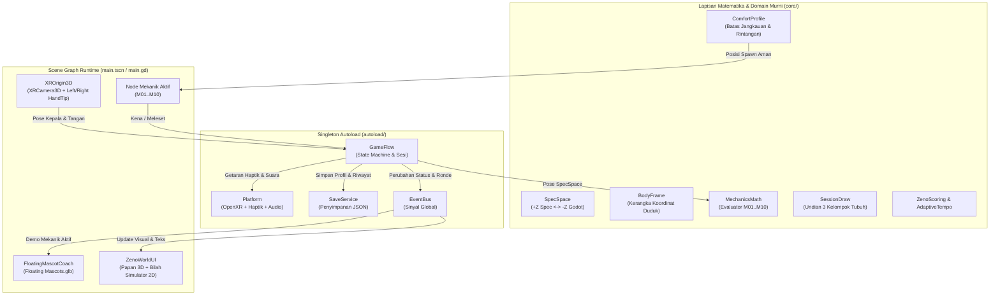

# ZenoFit (Godot 4.x) — Arsitektur & Cara Kerja Proyek

Dokumen ini menjelaskan arsitektur perangkat lunak, hierarki *scene*, aliran data per-frame, dan interaksi antar-subsistem pada implementasi **ZenoFit** di Godot 4.x (`mockup-v-1`).

---

## 1. Gambaran Umum Arsitektur

ZenoFit dirancang dengan prinsip **Pemisahan Tanggung Jawab (*Separation of Concerns*)**:
1. **Lapisan Domain & Matematika Murni (`core/`)**: Kelas-kelas `RefCounted` atau fungsi statis (`SpecSpace`, `BodyFrame`, `ComfortProfile`, `MechanicsMath`, `SessionDraw`, `ZenoScoring`, `AdaptiveTempo`, `ZenoGeometry`) yang bekerja sepenuhnya di dalam `SpecSpace` (`+Z` ke depan) dan dapat diuji secara *headless* tanpa bergantung pada node visual 3D.
2. **Lapisan Layanan Global (`autoload/`)**: Empat *singleton* Autoload Godot (`EventBus`, `Platform`, `SaveService`, `GameFlow`) yang mengelola mesin status aplikasi, inisialisasi OpenXR / Simulator Desktop, penyimpanan JSON lokal, serta komunikasi sinyal (*signal*) terdesentralisasi.
3. **Lapisan Scene 3D Interaktif (`main.gd`, `mechanics/`, `mascot/`, `ui/`)**: Memvisualisasikan target latihan di ruang 3D Godot (`-Z` ke depan), menggerakkan **Pelatih Maskot Mengambang (`Floating Mascots.glb`)** secara prosedural, serta menampilkan papan UI Dunia 3D dan bilah kontrol Simulator Desktop 2D.



---

## 2. Struktur Direktori Proyek

```text
/home/ramirez/XR/GodotMockup/mockup-v-1/
├── project.godot                      # Konfigurasi Godot 4.x (gl_compatibility, OpenXR Local space, Hand Tracking, Autoloads)
├── export_presets.cfg                 # Preset 0: PICO 4 Ultra APK | Preset 1: Meta Quest APK | Preset 2: Linux Desktop
├── openxr_action_map.tres             # Peta aksi OpenXR (PICO 4 Ultra pico4s_controller, pico4_controller, Touch Plus, Hand Ext)
├── main.tscn / main.gd                # Scene utama: Rig XR, Simulator Desktop, Arena, Maskot, UI, Mekanik
├── AGENTS.md                          # Aturan arsitektur & konvensi koordinat untuk pengembang
├── addons/
│   └── godotopenxrvendors/            # Plugin resmi OpenXR Vendors v5.2.0 (Loader PICO, Meta Quest, Khronos, AndroidXR)
├── assets/
│   └── Floating Mascots.glb           # Aset 3D pendamping (Torso, Arm_L, Arm_R, HeadShell, Visor, Leaf...)
├── autoload/
│   ├── event_bus.gd                   # Bus sinyal global (ronde, hit, keamanan, kalibrasi, maskot)
│   ├── platform.gd                    # Inisialisasi OpenXR (ruang LOCAL duduk), refresh rate, haptik, audio prosedural
│   ├── save_service.gd                # Penyimpanan JSON (comfort_profile.json, session_history.json, settings.json)
│   └── game_flow.gd                   # State machine utama, siklus ronde, integrasi kalibrasi & keamanan
├── core/
│   ├── enums.gd                       # AppState, MechanicId (M01..M10), SafetyLevel (A/B), DifficultyId, Hand
│   ├── spec_space.gd                  # Konversi Spec (+Z) <-> Godot (-Z) untuk posisi, arah, dan sudut yaw
│   ├── body_frame.gd                  # Sistem koordinat duduk pemain yang berpusat di O_body
│   ├── comfort_profile.gd             # Jangkauan terkalibrasi, skala k, bola eksklusi rintangan (r_ex = 0.12m)
│   ├── difficulty_preset.gd           # Kelas Resource untuk preset Gentle / Standard / Active
│   ├── geometry.gd                    # Deteksi tabrakan segmen-ke-bola anti-tunnelling
│   ├── adaptive_tempo.gd              # Penyesuaian BPM otomatis berdasarkan 8 target terakhir
│   ├── scoring.gd                     # Perhitungan skor dasar + ketepatan waktu + bonus kecepatan + kombo
│   ├── session_draw.gd                # Undian 5 ronde seimbang across 3 kelompok tubuh & substitusi Level A
│   └── mechanics_math.gd              # Evaluator matematika murni untuk seluruh 10 mekanik (M01..M10)
├── calibration/
│   └── calibration_controller.gd      # Kalibrasi Dasar 6 langkah, Pemeriksaan Cepat <=15 dtk, & Kalibrasi Modul Level B
├── safety/
│   └── safety_monitors.gd             # AutoPauseMonitor (pangkuan 2.0d), LeanMonitor (dengan override M10), RestReminder (8m)
├── mechanics/
│   ├── mechanic_base.gd               # Kelas dasar untuk 10 mekanik 3D
│   └── m01..m10/                      # Implementasi visual & gameplay untuk M01 hingga M10
├── mascot/
│   └── floating_mascot_coach.gd       # Rigging sendi prosedural & demonstrasi gerakan untuk Floating Mascots.glb
├── ui/
│   └── world_ui.gd                    # Papan UI 3D di ruang VR + bilah tombol klik 2D untuk Simulator Desktop
└── tests/
    ├── test_acceptance_suite.gd       # Suite pengujian otomatis AT-01..AT-28 + SpecSpace + Maskot (68 pengujian)
    └── run_acceptance_tests.gd        # Runner CLI SceneTree tanpa kepala (headless)
```

---

## 3. Cara Kerja Rigging & Animasi Prosedural `Floating Mascots.glb` (`FloatingMascotCoach`)

Aset 3D [`assets/Floating Mascots.glb`](../../assets/Floating%20Mascots.glb) memiliki 13 *mesh node* terpisah (`Torso`, `Neck`, `EmblemDisc`, `Leaf`, `Arm_L`, `Arm_R`, `HeadShell`, `Visor`, `Ear_L`, `Ear_R`, `Eye_L`, `Eye_R`, `Mouth_Smile`) yang titik asalnya diekspor pada `(0, 0, 0)`.

Agar maskot dapat menggerakkan lengan dan kepalanya secara anatomis tanpa merusak bentuk *mesh*, [`mascot/floating_mascot_coach.gd`](../../mascot/floating_mascot_coach.gd) melakukan **injeksi poros sendi (*pivot*) saat runtime** di `_setup_anatomical_pivots()`:
1. Membuat tiga node poros `Node3D` pada koordinat sendi yang dihitung dari batas geometri (*AABB*) *mesh*:
   - `LeftShoulderPivot` di `(-0.42, 0.92, 0.0)`
   - `RightShoulderPivot` di `(0.42, 0.92, 0.0)`
   - `NeckPivot` di `(0.0, 1.25, 0.0)`
2. Memindahkan induk (`reparent`) `Arm_L` ke `LeftShoulderPivot`, `Arm_R` ke `RightShoulderPivot`, serta seluruh bagian kepala/wajah ke `NeckPivot`, lalu menggeser `position` lokal masing-masing sebesar `-pivot.position` sehingga posisi istirahat visualnya tetap utuh.
3. **Demonstrasi 10 Latihan (`M01`–`M10`)**: Saat ronde dimulai atau mekanik dipilih, maskot secara otomatis memeragakan gerakan latihan tersebut (tinju bergantian untuk `M01`, jangkauan atas untuk `M02`, rentang sayap *T-Pose* untuk `M03`, dayung dua tangan untuk `M05`, putaran bahu untuk `M07`, menoleh halus untuk `M08`, dll.).
4. **Interaksi Sentuh / Colek (*Poke*)**: Jika tangan kiri atau kanan pemain menyentuh area maskot (`POKE_RADIUS_M = 0.22 m`), maskot akan memantul gembira, melambaikan tangan selama `1.6 detik`, memberikan getaran haptik ringan pada kontroler, dan memperbarui balon teks 3D di atas kepalanya.
