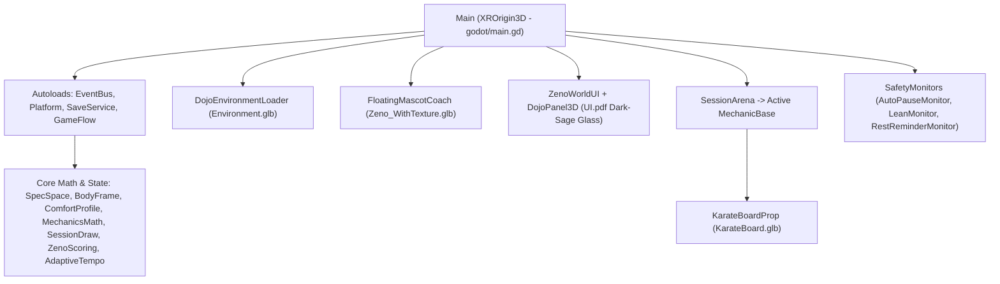

# 01 — Architecture & How ZenoFit v1.0 Works

> **Entry Scene:** `godot/main.tscn` (`Main` extending `XROrigin3D`, attached script `godot/main.gd`).

---

## 1. High-Level System Architecture

### Key Autoloads (`godot/project.godot`)
- `EventBus` (`autoload/event_bus.gd`): Decoupled signal bus (`state_changed`, `round_started`, `round_ended`, `target_hit`, `target_missed`, `session_paused`, `resume_countdown_tick`, `safety_cue`, `mascot_poked`, `mascot_demo_requested`).
- `Platform` (`autoload/platform.gd`): Isolates OpenXR initialization (`Local / Seated Reference Space`), strict Session Input Lock pose sampling (`sample_input_pose`), controller haptics, Passthrough blend mode, and procedural audio (`wood_crack`, `chime`, `gong`, `menu_click`, `miss`).
- `SaveService` (`autoload/save_service.gd`): Local JSON read/write (`calibration_profile.json`, `settings.json`, `sessions.json`, `personal_best.json`) with `/tmp/zenofit_userdata/` headless fallback.
- `GameFlow` (`autoload/game_flow.gd`): 11-screen state machine, `active_input_mode` lock, HUD distance/scale persistence, 5-round `Quick Break` playlist progression, and score aggregation.

---

## 2. Per-Frame Execution Pipeline (`Main._process`)

1. **Desktop Simulator Input (Non-XR only):** Updates virtual head pose (`xr_camera`) and virtual left/right hands when OpenXR is inactive.
2. **Stationary `BodyFrame` Guard (`_sync_xr_camera_body_frame`):** Rebuilds `GameFlow.body_frame` strictly once on initial valid XR camera pose, during Calibration Step 1 (`SEAT_ANCHOR`), or on explicit View Recenter — NEVER per frame during gameplay or menu navigation.
3. **Session Input Lock Sampling (`_update_tracked_poses`):** Calls `Platform.sample_input_pose(hand, ctrl, mode)` using the locked session input (`CONTROLLER` or `HAND_TRACKING`). Computes chest-relative `SpecSpace` coordinates (`prev` and `curr`), smoothed 3-frame velocities, and wrist roll angles.
4. **Menu Laser vs. Gameplay Anti-Cheat:** Checks `is_ui_raycast_enabled()` (`current_state != AppState.ROUND_PLAY`). Hides controller laser beams and pointer dot throughout `ROUND_PLAY`.
5. **Round Logic & Safety (`ROUND_PLAY`):**
   - Evaluates `AutoPauseMonitor` (`2.0 s` hands-in-lap / lower-zone drop), `LeanMonitor` (`|dx| > 0.22 m` for `0.50 s`), `RestReminderMonitor`, and `INPUT_LOST` tracking drop (`> 1.2 s`).
   - Invokes `active_mechanic.update_mechanic(...)`.
6. **Mascot & Spatial UI Update:** Updates `FloatingMascotCoach` (FoV-safe anchor `<= 23°` + live exercise joint demos) and `ZenoWorldUI` (world-locked inside `BodyFrame` at `hud_distance_m` and `hud_scale`).

---

## 3. `MechanicBase` Autoload-Safe Pattern

When headless acceptance tests run with `godot -s res://tests/run_acceptance_tests.gd`, Godot does not mount project autoloads as global compile-time identifiers. `MechanicBase` (`godot/mechanics/mechanic_base.gd`) resolves `GameFlow`, `Platform`, and `EventBus` dynamically from `arena_root.get_tree().root` (`_gf()`, `_plat()`, `_eb()`) with local `RoundScoreTracker` / `AdaptiveTempo` fallbacks when detached from a scene tree. Every exercise subclass should inherit `MechanicBase` and use `_record_hit_and_notify`, `_record_miss_and_notify`, `_play_haptic`, `_set_node_world_pos`, and `_retire_node`.

---

## 4. `KarateBoardProp` Fracture Pipeline (`godot/mechanics/karate_board_prop.gd`)

1. `setup_board(accent_color)`: Instantiates `res://assets/KarateBoard.glb` (with `GLTFDocument` buffer fallback via `_load_raw_glb`), disables shadow casting, locates `Board_Intact`, `Board_Half_Left`, `Board_Half_Right`, `Splinter_1..6`, and `AnimationPlayer`, and attaches subtle glowing `AccentTop` / `AccentBottom` cue strips (`Mint` left, `Amber` right).
2. `set_intact_state()`: Displays `Board_Intact` and hides fracture halves and splinters.
3. `trigger_break()`: Hides `Board_Intact`, reveals halves & splinters, plays the non-looping `Break` animation (`0.60 s`), and frees the node cleanly after `0.65 s` via `SceneTreeTween`.

---

## 5. `DojoPanel3D` Spatial UI Pipeline (`godot/ui/dojo_panel_3d.gd`)

Each 3D panel binds a transparent `SubViewport` onto an unshaded `QuadMesh` (`cull_mode = CULL_DISABLED`, shadow casting OFF). `intersect_ray(origin, dir)` transforms the incoming ray into panel local space using `global_transform.affine_inverse()` (making hit testing automatically accurate across all `hud_scale` values), projects local `[-w/2, +w/2] × [-h/2, +h/2]` onto `viewport_px`, and feeds synthetic `InputEventMouseMotion` / `InputEventMouseButton` events directly into `SubViewport.push_input()`.

---

## 6. Adding a New Curated Exercise Cleanly

1. Add the enum ID and user-facing strings (`title`, `tagline`, `area`, `cue`, `preview_steps`, `category`, `safety_level`) in `godot/core/enums.gd`. Do NOT expose internal IDs like `M08` in UI strings.
2. Add the pure math + anti-cheat formula as static methods in `godot/core/mechanics_math.gd`.
3. Register the ID in `SessionDraw.get_all_exercises()` (`godot/core/session_draw.gd`) and register its class instantiation in `Main._on_round_started()` (`godot/main.gd`).
4. Implement the `MechanicBase` subclass under `godot/mechanics/<name>/` and add a matching procedural demo pose branch in `FloatingMascotCoach._animate_joints()`.
5. Add pure-math and live-instantiation assertions in `godot/tests/test_acceptance_suite.gd`.
