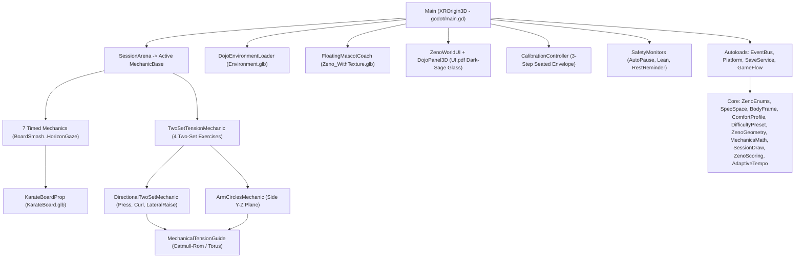

# 01 — Architecture & How ZenoFit v1.0 Works

> **Entry Scene:** [`godot/main.tscn`](../../../godot/main.tscn) (`Main` extending `XROrigin3D`, attached script [`godot/main.gd`](../../../godot/main.gd)).
> **Detailed Specs:** [`berkas/GodotDocs/AI-Spec/00-README.md`](../AI-Spec/00-README.md) (1:1 Code ↔ Spec Traceability Matrix).

---

## 1. High-Level System Architecture & Scene Tree

### Scene Tree Composition (`godot/main.tscn` + Runtime Nodes)
- **Static scene nodes (`main.tscn`):** `XRCamera3D`, `LeftController` (`tracker = &"left_hand"`), `RightController` (`tracker = &"right_hand"`).
- **Runtime nodes mounted by `Main._ready()`:** `WorldEnvironment`, `DirectionalLight3D` (`shadow_enabled = false`), `StaticSeatedReferencePlatform` (hidden automatically once `Environment.glb` loads), `ZenDojoEnvironment` (`dojo_env_root`), `SessionArena` (`arena_root`), `FloatingMascotCoach` (`mascot_coach`), `WorldUI` (`world_ui`), `LeftHandTip`, `RightHandTip`, `LeftMenuRay`, and `RightMenuRay`.

### Key Autoloads (`godot/project.godot`)
- `EventBus` (`autoload/event_bus.gd`): Decoupled signal bus exposing 10 signals (`state_changed`, `round_started`, `round_ended`, `target_hit`, `target_missed`, `session_paused`, `resume_countdown_tick`, `safety_cue`, `mascot_poked`, `mascot_demo_requested`).
- `Platform` (`autoload/platform.gd`): Isolates OpenXR initialization (`Reference Space = Local / Seated`), strict Session Input Lock pose sampling (`sample_input_pose`, including `hand_tracking_sim` on Desktop Simulator), UI pointer ray construction (`get_ui_pointer_ray`), controller haptics (`play_haptic_light_touch`, `play_haptic_light_strike`, `play_haptic_solid_strike`), Passthrough blend mode (`set_passthrough`), recenter signaling (`tracking_origin_recentered`), and procedural WAV audio (`wood_crack`, `chime`, `gong`, `menu_click`, `miss`).
- `SaveService` (`autoload/save_service.gd`, `SaveServiceClass`): Local JSON read/write (`calibration_profile.json`, `settings.json`, `sessions.json`, `personal_best.json`) under `user://` with automatic `/tmp/zenofit_userdata/` fallback in sandboxed/headless runs.
- `GameFlow` (`autoload/game_flow.gd`, `GameFlowController`): State machine across 16 `ZenoEnums.AppState` values driving the 11-screen flow, `active_input_mode` session lock, `hud_distance_m` (`1.30–2.20 m`) & `hud_scale` (`0.85–1.20x`) persistence, 5-round `Quick Break` playlist across **11 curated exercises**, explicit two-set round completion (`require_explicit_round_completion` / `complete_active_round()`), and score/rank/personal-best aggregation.

---

## 2. Per-Frame Execution Pipeline (`Main._process`)

1. **Desktop Simulator Input (`_handle_desktop_simulator_input`, Non-XR only):** Updates virtual head pose (`xr_camera`), virtual left/right hand sphere positions (`Q` / `E` + mouse + wheel depth), and simulated wrist roll (`[` / `]`) when `Platform.is_xr_active == false`.
2. **Stationary `BodyFrame` Guard (`_sync_xr_camera_body_frame`):** Rebuilds `GameFlow.body_frame` strictly once on initial valid XR camera pose (`_has_initial_xr_pose`), during Calibration Step 1 (`SEAT_ANCHOR`), or on explicit View Recenter (`_recenter_seated_view`) — NEVER per frame during gameplay or menu browsing. `_sync_dojo_floor_transform()` keeps `dojo_env_root` and `floor_platform` anchored at `BodyFrame` local `(0.0, -0.68, 0.0)`.
3. **Session Input Lock Sampling (`_update_tracked_poses`):** Uses `GameFlow.active_input_mode` inside `ROUND_INTRO / ROUND_PLAY / ROUND_OUTRO` (and `settings["input_mode"]` in menus) to call `Platform.sample_input_pose(hand, ctrl, mode)`. Converts pinch edge-triggers in `HAND_TRACKING` mode into `trigger_click` UI actions, transforms hand positions into chest-relative `SpecSpace`, and computes 3-frame smoothed velocities and wrist roll angles.
4. **Menu Laser vs. Gameplay Anti-Cheat:** Checks `is_ui_raycast_enabled()` (`GameFlow.current_state != ZenoEnums.AppState.ROUND_PLAY`). Hides controller laser beams (`left_menu_ray`, `right_menu_ray`) and `ZenoWorldUI._pointer_dot` throughout `ROUND_PLAY`, and keeps `arena_root` hidden outside `ROUND_INTRO / ROUND_PLAY / ROUND_OUTRO` (including while `PAUSED`).
5. **Round Logic, Safety & VFX (`ROUND_PLAY`):**
   - Advances `GameFlow.advance_round_timer(delta)`.
   - Evaluates `SafetyMonitors` in order:
     - `AutoPauseMonitor`: `2.0 s` hands-in-lap (`<= 0.15 m`) or lower-zone (`y <= -0.15 m`) tracking drop -> `PauseReason.AUTO_PAUSE_LAP` (auto-enables Passthrough if supported).
     - `INPUT_LOST`: in XR, if any enabled hand reports `tracked == false` continuously for `>= 2.5 s` (`_input_lost_timer_s >= 2.5`) -> `PauseReason.INPUT_LOST`.
     - `LeanMonitor`: `|head_local_x - seat_anchor_local_x| > 0.22 m` for `0.50 s` -> pauses with `PauseReason.LEAN_WARNING`.
     - `RestReminderMonitor`: `7.0–10.0 min` (default `8.0 min`) -> `PauseReason.REST_REMINDER`.
   - Ticks `active_mechanic.update_mechanic(...)`, checks `active_mechanic.has_two_set_completion() and active_mechanic.is_exercise_completed()` to finish the round via `GameFlow.complete_active_round()`, and spawns hand motion trails (`speed >= 0.35 m/s`) plus floating `Label3D` score popups (`_spawn_hit_burst_vfx`).
6. **Mascot, Spatial UI & Ray Routing:** Updates `FloatingMascotCoach` (FoV-safe anchor `<= 23°` + live procedural demos for all 11 exercises), updates `ZenoWorldUI` (world-locked inside `BodyFrame` at `hud_distance_m` and `hud_scale`), and routes UI pointer rays only when `is_ui_raycast_enabled()` is `true`.

---

## 3. `MechanicBase` & 11-Exercise Class Architecture

### Autoload-Safe Pattern & Shared Helpers (`godot/mechanics/mechanic_base.gd`)
When headless acceptance tests run with `godot -s res://tests/run_acceptance_tests.gd`, Godot does not mount project autoloads as global compile-time identifiers. `MechanicBase` resolves `GameFlow`, `Platform`, and `EventBus` dynamically from `arena_root.get_tree().root` (`_gf()`, `_plat()`, `_eb()`) with local `RoundScoreTracker` / `AdaptiveTempo` fallbacks when detached from a scene tree.

Every exercise subclass inherits `MechanicBase` and reuses:
- **Scoring & feedback:** `_record_hit_and_notify()`, `_record_direct_hit_and_notify()`, `_record_miss_and_notify()`, `_play_haptic()`, `_emit_safety_cue()`.
- **Ergonomic & lifecycle helpers:** `get_effective_hit_radius()` (`+0.025 m` under `HAND_TRACKING`), `pick_hand_for_spawn()`, `_set_node_world_pos()`, `_set_node_world_rot()`, `_retire_node()`.
- **Shared procedural visuals & VFX (`SHADOW_CASTING_SETTING_OFF`):** `create_glow_orb()`, `create_target_box()`, `create_glow_ring()`, `create_lantern_prop()`, `create_dial_prop()`, `create_aim_beam()`, `spawn_hit_vfx()`, `spawn_prime_vfx()`, and `spawn_celebration_vfx()`.

### 11-Exercise Inheritance Hierarchy
- **Timed Rhythm-Flow Exercises (`7` direct `MechanicBase` subclasses, `30.0 s` / `45.0 s`):**
  - `BoardSmashMechanic` (`board_smash/board_smash.gd`) — Seated punches (`front` / `hook` / `uppercut`) shattering `KarateBoardProp`.
  - `WideSplitMechanic` (`wide_split/wide_split.gd`) — Chest prime + `20°` scapular split shattering twin `KarateBoardProp`.
  - `SkyReachMechanic` (`sky_reach/sky_reach.gd`) — Diagonal upward reach (`<= 45°` gaze elevation) catching mint/gold lanterns.
  - `OrbitFlowMechanic` (`orbit_flow/orbit_flow.gd`) — XY-plane shoulder circles with signed-angle anti-cheat & cadence band.
  - `WristTwistMechanic` (`wrist_twist/wrist_twist.gd`) — Steady forearm + wrist roll dials (`±target_deg`).
  - `TorsoTwistMechanic` (`torso_twist/torso_twist.gd`, **Level B**) — Chest guard + head-torso yaw sync toward side `KarateBoardProp`.
  - `HorizonGazeMechanic` (`horizon_gaze/horizon_gaze.gd`, **Level B**) — Slow horizontal neck scan (`<= 60°/s`, `1.0 s` dwell).
- **Two-Set Mechanical Tension Exercises (`4` subclasses extending `TwoSetTensionMechanic` (`2 × 12` reps, `1.6 s` transition, `0.12 m` base tolerance, `>= 0.65` quality bonus)):**
  - `DirectionalTwoSetMechanic` (polyline Catmull-Rom `MechanicalTensionGuide` with `1.0 s / 0.6 s / 2.0 s` tempo bead + prime-then-hit):
    - `ShoulderPressMechanic` (`shoulder_press/shoulder_press.gd`) — Vertical overhead `Box` press (`Set 1: Upward`, `Set 2: Downward`).
    - `BicepCurlMechanic` (`bicep_curl/bicep_curl.gd`) — Curved `Orb` curl arc (`Set 1: Flexion`, `Set 2: Extension`).
    - `LateralRaiseMechanic` (`lateral_raise/lateral_raise.gd`) — Quarter-sine lateral `Box` raise (`Set 1: Raising`, `Set 2: Lowering`).
  - `ArmCirclesMechanic` (`arm_circles/arm_circles.gd`) — Side-plane (`"yz"`) circular `MechanicalTensionGuide` + 4 checkpoint orbs + signed-direction validation (`Set 1: Clockwise`, `Set 2: Counterclockwise`).

---

## 4. `KarateBoardProp` Fracture Pipeline (`godot/mechanics/karate_board_prop.gd`)

1. `setup_board(accent_color)`: Instantiates `res://assets/KarateBoard.glb` (with `GLTFDocument` buffer fallback via `_load_raw_glb`), disables shadow casting, locates `Board_Intact`, `Board_Half_Left`, `Board_Half_Right`, `Splinter_1..6`, and `AnimationPlayer`, and attaches glowing `AccentTop` / `AccentBottom` cue strips (`Mint` left, `Amber` right).
2. `set_intact_state()`: Displays `Board_Intact` and hides fracture halves and splinters.
3. `trigger_break()`: Hides `Board_Intact`, reveals halves & splinters, plays the non-looping `Break` animation (`0.60 s`), and frees the node cleanly after `0.65 s` via `SceneTreeTween`. Used by `BoardSmashMechanic`, `WideSplitMechanic`, and `TorsoTwistMechanic`.

---

## 5. `DojoPanel3D` & `ZenoWorldUI` Spatial UI Pipeline (`godot/ui/`)

- **`DojoPanel3D` (`dojo_panel_3d.gd`):** Binds a transparent `SubViewport` onto an unshaded `QuadMesh` (`cull_mode = CULL_DISABLED`, shadow casting OFF). `intersect_ray(origin, dir)` transforms the ray into panel local space (`global_transform.affine_inverse()`, valid hit distance `0.05 < t <= 6.0 m`), maps `[-w/2, +w/2] × [-h/2, +h/2]` onto `viewport_px`, and pushes synthetic `InputEventMouseMotion` / `InputEventMouseButton` events directly into `SubViewport.push_input()`.
- **`ZenoWorldUI` (`world_ui.gd`):** Builds the 11-screen *Dark-Sage Glassmorphism* flow (`UI.pdf`) inside `BodyFrame` at `hud_distance_m` and `hud_scale`. Automatically switches `Exercise Library` to a compact 4-column grid when displaying `> 8` items (fitting all 11 cards cleanly), renders the optional dumbbell guidance card on `Exercise Preview` (`Shoulder Press`, `Bicep Curl`, `Arm Circles`), displays live `Set X / 2` rep text in the compact round HUD, and offers `Switch Input Mode & Resume` when paused due to `INPUT_LOST`.

---

## 6. Adding a New Curated Exercise Cleanly

1. Add the enum ID and user-facing strings (`title`, `tagline`, `area`, `cue`, `preview_steps`, `category`, `safety_level`, plus `get_exercise_dumbbell_note()` if applicable) in [`godot/core/enums.gd`](../../../godot/core/enums.gd). Do NOT expose internal debug IDs like `M01..M10` in UI strings.
2. Place pure math + anti-cheat helpers in [`godot/core/mechanics_math.gd`](../../../godot/core/mechanics_math.gd) (or extend `TwoSetTensionMechanic` / `DirectionalTwoSetMechanic` + `MechanicalTensionGuide` for two-set exercises).
3. Register the ID in `SessionDraw.get_all_exercises()` ([`godot/core/session_draw.gd`](../../../godot/core/session_draw.gd)) and map it in `Main._instantiate_exercise()` ([`godot/main.gd`](../../../godot/main.gd)).
4. Implement the `MechanicBase` subclass under `godot/mechanics/<name>/` and add a matching procedural demo pose branch in `FloatingMascotCoach._animate_joints()` ([`godot/mascot/floating_mascot_coach.gd`](../../../godot/mascot/floating_mascot_coach.gd)).
5. Add pure-math and live-instantiation assertions in [`godot/tests/test_acceptance_suite.gd`](../../../godot/tests/test_acceptance_suite.gd).
6. Refresh the Godot class cache (`godot --headless --xr-mode off --path godot --import`), run `run_acceptance_tests.gd`, and update [`AI-Spec/`](../AI-Spec/00-README.md) 1:1.
